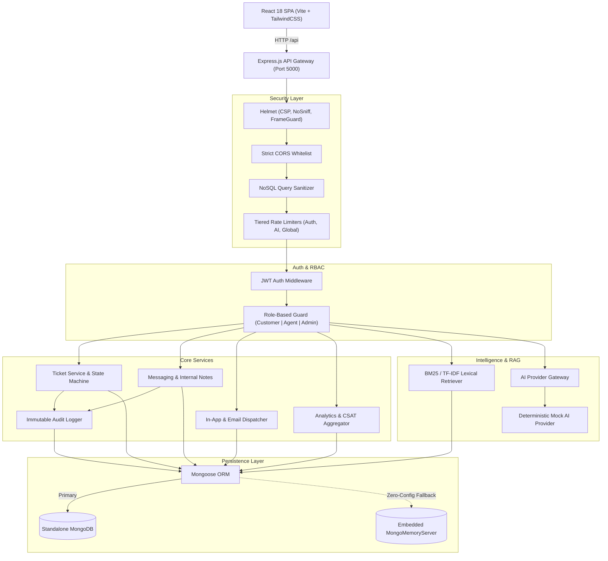
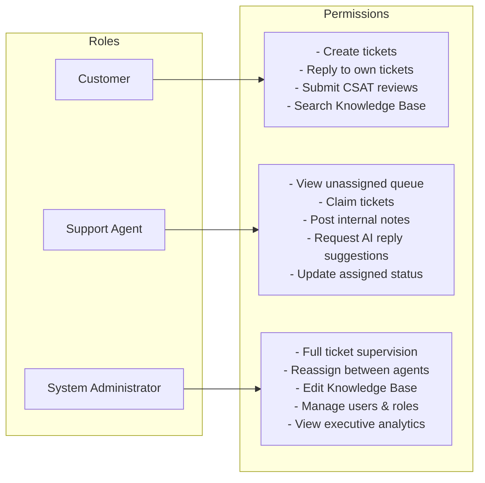

# AI Support & Operations Platform

[](#17-testing-and-verified-results)
[](#8-prerequisites)
[](LICENSE)
[](#3-tech-stack)
[](#3-tech-stack)

An enterprise-grade customer support, agent operations, and service management platform. Built with a full-stack React and Express architecture, the platform features deterministic ticket lifecycle state machines, role-based access control (RBAC), private internal collaboration threads, automated customer satisfaction (CSAT) scoring, live SLA metrics, a lexical Retrieval-Augmented Generation (RAG) knowledge engine, and an extensible AI provider gateway.

---

## Table of Contents

- [1. Project Overview](#1-project-overview)
- [2. Key Features Implemented](#2-key-features-implemented)
- [3. Tech Stack](#3-tech-stack)
- [4. Screenshots and UI Walkthrough](#4-screenshots-and-ui-walkthrough)
- [5. Architecture Overview](#5-architecture-overview)
- [6. Architecture Diagram](#6-architecture-diagram)
- [7. Project Directory Structure](#7-project-directory-structure)
- [8. Prerequisites](#8-prerequisites)
- [9. Installation & Quickstart](#9-installation--quickstart)
- [10. Environment Variable Reference](#10-environment-variable-reference)
- [11. Running Frontend and Backend Locally](#11-running-frontend-and-backend-locally)
- [12. Database Setup & In-Memory Fallback](#12-database-setup--in-memory-fallback)
- [13. Available NPM Scripts](#13-available-npm-scripts)
- [14. API Overview](#14-api-overview)
- [15. Authentication & Authorization (RBAC)](#15-authentication--authorization-rbac)
- [16. AI Functionality (Mock AI vs. External Providers)](#16-ai-functionality-mock-ai-vs-external-providers)
- [17. Testing and Verified Results](#17-testing-and-verified-results)
- [18. Security Practices & Hardening](#18-security-practices--hardening)
- [19. Known Limitations & Roadmap](#19-known-limitations--roadmap)
- [20. Contributing](#20-contributing)
- [21. License](#21-license)

---

## 1. Project Overview

Modern customer operations require a balance between structured workflows, data isolation, and intelligent assistance. The **AI Support & Operations Platform** was engineered to model how high-velocity B2B support desks handle ticket lifecycles from intake to resolution:

- **Strict Separation of Concerns**: Customers, Support Agents, and Administrators have dedicated, role-scoped portals with strict backend security boundaries.
- **Auditable Lifecycle Management**: Support tickets follow a deterministic state machine transitions (`OPEN` $\rightarrow$ `ASSIGNED` $\rightarrow$ `IN_PROGRESS` $\rightarrow$ `WAITING_FOR_CUSTOMER` $\rightarrow$ `RESOLVED` $\rightarrow$ `CLOSED`).
- **Internal Staff Privacy**: Support teams can collaborate via private internal notes that are strictly isolated from customer-facing conversation streams and audit histories.
- **Grounded Knowledge Retrieval**: A self-contained lexical RAG engine segments published documentation into semantic chunks and provides grounded Q&A with verifiable source citations.
- **Operational Analytics**: Native aggregation pipelines measure Mean Time to Resolution (MTTR), First Response Time (FRT), agent active workloads, and CSAT percentage benchmarks.

---

## 2. Key Features Implemented

### Customer Portal
- **Ticket Submission**: Create support tickets with automated ticket ID generation (`TCK-XXXXX`), priority levels, and categorization.
- **Conversation Thread**: Interactive messaging history displaying verified agent identities, avatars, and timestamps.
- **CSAT Feedback**: Interactive 1–5 star rating modal with comments for resolved or closed tickets. Enforces ownership and duplicate prevention.
- **Self-Service Knowledge Base**: Search published knowledge articles with real-time category filtering and reading view.
- **In-App Notifications**: Real-time notification badge with mark-as-read and mark-all-read capabilities.

### Agent Operations Workspace
- **Queue Management**: Filter tickets by assigned workload, unassigned queue, priority, and category.
- **Single-Click Ticket Claiming**: Claim unassigned tickets directly into an individual agent workload queue.
- **Staff Collaboration**: Toggle between public customer responses and private, yellow-badged internal notes.
- **Lifecycle Management**: Advance tickets through verified state machine stages with automated SLA timestamp recording.
- **AI Assist**: Contextual reply draft suggestions and automated ticket analysis (sentiment, priority, intent).

### Administrator Command Console
- **Platform Analytics**: Executive KPI cards (Total Volume, MTTR, First-Response Time, CSAT Benchmark Score).
- **Breakdown Charts**: Ticket distribution across statuses, priorities, categories, and 1–5 star ratings.
- **Agent Workload Supervision**: Live active ticket counts, resolved ticket counts, and individual agent CSAT averages.
- **User & Agent Directory**: Search, filter, paginate, activate/deactivate accounts, and edit departments.
- **Knowledge Article Editor**: Create, edit, publish/unpublish, and delete articles with automatic semantic pre-chunking.

---

## 3. Tech Stack

### Frontend
- **Framework**: React 18.3 (Vite 6.0)
- **Routing**: React Router DOM 6.28
- **Styling**: TailwindCSS 3.4 with custom design tokens, dark mode palette, and responsive layouts
- **Icons**: Lucide React
- **HTTP Client**: Axios with automatic request interceptors and token lifecycle handling

### Backend
- **Runtime**: Node.js (CommonJS)
- **Framework**: Express.js 4.21
- **Database & ODM**: MongoDB with Mongoose 8.9
- **In-Memory Fallback**: `mongodb-memory-server` 10.1 (zero-config development engine)
- **Authentication**: JWT (`jsonwebtoken` 9.0) with bcrypt password hashing (`bcryptjs` 3.0)
- **Security**: Helmet 8.0, strict CORS, express-rate-limit 8.7, custom NoSQL operator sanitizer, and ReDoS protection

---

## 4. Screenshots and UI Walkthrough

*(Placeholder links below point to [docs/screenshots/](docs/screenshots/README.md). Add your real screenshot captures to populate.)*

| Customer Portal | Agent Workspace |
| :---: | :---: |
| <br>*Customer ticket intake and status tracking* | <br>*Unassigned queue and workload management* |

| Ticket Conversation & Notes | AI Intelligence & RAG |
| :---: | :---: |
| <br>*Public messaging vs. private internal staff notes* | <br>*Grounded lexical RAG question-answering* |

| Executive Analytics Dashboard | CSAT Review Experience |
| :---: | :---: |
| <br>*KPI summary cards, SLA durations, and CSAT breakdown* | <br>*1–5 star customer feedback submission* |

---

## 5. Architecture Overview

The system is structured as a decoupled client-server architecture:

1. **Client Tier**: A single-page application built with React and TailwindCSS. Communicates via REST APIs with `/api` path prefixes proxied by Vite in local development.
2. **Security & Gateway Tier**: Express application hardened with Helmet CSP headers, origin-restricted CORS, payload size caps (2MB), NoSQL operator stripping, and tiered rate limiters.
3. **Domain & Service Tier**: Controller and service modules isolating business rules:
   - State machine transition validator.
   - Assignment policy enforcer.
   - Lexical BM25 chunk indexer and retriever.
   - AI provider abstraction layer.
4. **Data Tier**: Mongoose schemas enforcing compound indexes, field-level access control (`select: false` on password hashes), and audit logging.

For an in-depth breakdown, see [docs/ARCHITECTURE.md](docs/ARCHITECTURE.md).

---

## 6. Architecture Diagram



---

## 7. Project Directory Structure

```text
AI-System-project/
├── backend/
│   ├── src/
│   │   ├── config/              # DB connection, env variables, fallbacks
│   │   ├── controllers/         # REST controllers (auth, ticket, analytics, etc.)
│   │   ├── middleware/          # JWT auth, RBAC, error handler, rate limiters, sanitizers
│   │   ├── models/              # Mongoose schemas (User, Ticket, Message, Article, etc.)
│   │   ├── routes/              # Express route declarations
│   │   ├── services/            # AI strategy gateway, mock provider, RAG retriever
│   │   ├── utils/               # API response envelopes, logger, audit logging, sanitization
│   │   ├── validators/          # Input boundary validators (auth, tickets, articles, messages)
│   │   ├── app.js               # Express application initialization and middleware
│   │   └── server.js            # Server entry point, database bootstrap, demo seeders
│   ├── test-*.js                # 8 automated verification test suites (127 total tests)
│   ├── .env.example             # Backend environment variables template
│   └── package.json             # Backend dependencies and test scripts
├── frontend/
│   ├── src/
│   │   ├── components/          # Reusable components (CsatModal, NotificationBell, portals)
│   │   ├── context/             # AuthContext session provider
│   │   ├── pages/               # Dashboard, TicketDetail, AdminAnalytics, KnowledgeBase, Auth
│   │   ├── services/            # Axios API service clients
│   │   ├── config/              # Axios instance and response interceptors
│   │   ├── App.jsx              # Main routing and role-protected route guards
│   │   └── index.css            # Custom Tailwind CSS styling tokens
│   ├── package.json             # Frontend dependencies and Vite build scripts
│   ├── tailwind.config.js       # Design system theme configuration
│   └── vite.config.js           # Vite dev server and /api proxy configuration
├── docs/
│   ├── ARCHITECTURE.md          # Comprehensive architectural specification
│   ├── API.md                   # Full REST API endpoints, schemas, and permissions
│   └── screenshots/             # Visual UI capture directory and guidelines
├── .env.example                 # Root environment template
├── .gitignore                   # Security-hardened git exclusion rules
├── CONTRIBUTING.md              # Local development and pull request guide
├── LICENSE                      # MIT License
├── package.json                 # Monorepo root scripts
└── README.md                    # Flagship repository documentation
```

---

## 8. Prerequisites

- **Node.js**: `v18.x` or `v20.x` LTS
- **npm**: `v9.x` or `v10.x`
- **MongoDB** *(Optional)*: Standalone MongoDB `v6.x+`. If not installed or running, the backend automatically boots an embedded in-memory MongoDB server for zero-configuration local execution.

---

## 9. Installation & Quickstart

1. **Clone the repository**:
   ```bash
   git clone https://github.com/<your-username>/ai-support-platform.git
   cd ai-support-platform
   ```

2. **Install all dependencies** (installs root, backend, and frontend packages):
   ```bash
   npm run install:all
   ```

3. **Configure environment variables**:
   ```bash
   cp .env.example backend/.env
   ```
   *(The default settings work immediately with zero changes required.)*

4. **Start the local development servers**:
   In two separate terminal tabs:

   **Terminal 1 (Backend API)**:
   ```bash
   npm run backend
   ```
   *Starts on `http://localhost:5000` (auto-reloads on edits via nodemon).*

   **Terminal 2 (Frontend Client)**:
   ```bash
   npm run frontend
   ```
   *Starts on `http://localhost:5173` (Vite dev server with HMR).*

5. **Open in browser**:
   Navigate to `http://localhost:5173`. Use the **Developer Quick-Login Bar** at the top of the screen to sign in as **Customer**, **Agent**, or **Admin** with a single click.

---

## 10. Environment Variable Reference

| Variable | Default Value | Description | Required in Prod |
| :--- | :--- | :--- | :---: |
| `PORT` | `5000` | Port on which the Express API server listens. | No |
| `NODE_ENV` | `development` | Environment mode (`development`, `production`, `test`). | Yes |
| `CLIENT_URL` | `http://localhost:5173` | Allowed frontend origin for CORS and CSP validation. | Yes |
| `MONGODB_URI` | `mongodb://127.0.0.1:27017/ai_support_platform` | MongoDB connection string. Falls back to in-memory server in dev if unreachable. | Yes |
| `JWT_SECRET` | `dev_jwt_secret_...` | Secret key for signing JWT tokens (min 32 characters in production). | Yes |
| `JWT_EXPIRES_IN` | `7d` | Token validity duration. | No |
| `AI_PROVIDER` | `mock` | Active AI strategy (`mock`, `gemini`, `groq`). | No |
| `GEMINI_API_KEY` | *(empty)* | Optional API key for Google Gemini provider. | No |
| `GROQ_API_KEY` | *(empty)* | Optional API key for Groq AI provider. | No |
| `EMAIL_ENABLED` | `false` | Enable outbound email dispatch via SMTP. | No |
| `EMAIL_FROM` | `support@aiplatform.local` | Sender email address for outbound alerts. | No |
| `SMTP_HOST` | `smtp.mailtrap.io` | SMTP server host for email delivery. | No |
| `SMTP_PORT` | `587` | SMTP server port. | No |
| `SMTP_USER` | *(empty)* | SMTP authentication username. | No |
| `SMTP_PASS` | *(empty)* | SMTP authentication password. | No |

---

## 11. Running Frontend and Backend Locally

### Monorepo Root Commands
```bash
npm run install:all     # Installs backend and frontend dependencies
npm run backend         # Starts the backend server (http://localhost:5000)
npm run frontend        # Starts the Vite frontend dev server (http://localhost:5173)
npm run build           # Creates the production frontend bundle
npm test                # Executes all 8 backend automated verification suites
```

### Pre-Seeded Demo Accounts
On initial boot, the database is automatically seeded with ready-to-test accounts:

| Role | Email | Password | Access Highlights |
| :--- | :--- | :--- | :--- |
| **System Admin** | `admin@platform.com` | `AdminPass123!` | System configuration, user/agent management, full ticket control, analytics dashboard. |
| **Support Agent** | `agent@platform.com` | `AgentPass123!` | Queue triage, ticket claiming, private internal notes, AI reply assistance. |
| **Customer** | `customer@platform.com` | `CustomerPass123!` | Ticket creation, conversation replies, CSAT review submission. |

---

## 12. Database Setup & In-Memory Fallback

The backend uses a resilient, dual-mode database connection strategy implemented in [backend/src/config/db.js](backend/src/config/db.js):

1. **External MongoDB Connection**: The server first attempts to connect to the configured `MONGODB_URI` with a 2.5-second connection timeout.
2. **Automatic In-Memory Fallback**: If an external MongoDB instance is not reachable and `NODE_ENV !== 'production'`, the server automatically starts an embedded in-memory MongoDB instance via `mongodb-memory-server`.
3. **Production Safety**: When running with `NODE_ENV=production`, the in-memory fallback is disabled; the server strictly requires a verified external MongoDB cluster and exits safely if unreachable.

---

## 13. Available NPM Scripts

### Root (`package.json`)
```bash
npm run install:all     # Install dependencies in both backend and frontend
npm run backend         # Start backend via nodemon
npm run frontend        # Start frontend via Vite
npm run build           # Build frontend production bundle in frontend/dist
npm test                # Run all 127 automated backend tests across all phases
```

### Backend (`backend/package.json`)
```bash
npm start               # Start backend in production mode (node src/server.js)
npm run dev             # Start backend in development mode with nodemon
npm test                # Execute all 8 test suites sequentially
npm run test:security   # Phase 10: Security hardening, NoSQL injection, notes isolation
npm run test:analytics  # Phase 9: Dashboard metrics, SLA timing, CSAT distribution
npm run test:knowledge  # Phase 8: Knowledge base management, BM25 retrieval, RAG Q&A
npm run test:ai         # Phase 7: Deterministic AI analysis and reply suggestions
npm run test:messaging  # Phase 6: Ticket conversations, private notes, notifications
npm run test:tickets    # Phase 4/5: Ticket state machine and lifecycle transitions
npm run test:users      # Phase 3: User/agent management, profile updates, status
npm run test:auth       # Phase 2: Registration, login, password hashing, JWT guards
```

### Frontend (`frontend/package.json`)
```bash
npm run dev             # Start local development server with HMR
npm run build           # Typecheck and compile production bundle into dist/
npm run preview         # Preview local production build
```

---

## 14. API Overview

Comprehensive API documentation with schema examples, query filters, and response envelopes is available in [docs/API.md](docs/API.md). Below is a summary of primary routes:

| Route | Method | Access | Description |
| :--- | :---: | :---: | :--- |
| `/api/auth/register` | `POST` | Public | Register customer account with bcrypt hashing. |
| `/api/auth/login` | `POST` | Public | Authenticate user and issue JWT bearer token. |
| `/api/auth/logout` | `POST` | Authenticated | Terminate session cleanly. |
| `/api/auth/me` | `GET` | Authenticated | Retrieve authenticated user profile. |
| `/api/tickets` | `POST` | Customer, Admin | Create a new ticket with automatic `TCK-XXXXX` ID. |
| `/api/tickets` | `GET` | Authenticated | Scoped list (Customer: own; Agent: assigned/queue; Admin: all). |
| `/api/tickets/:id` | `GET` | Authenticated | Ticket details with role-scoped audit history. |
| `/api/tickets/:id/status` | `PATCH` | Authenticated | Advance status through state machine rules. |
| `/api/tickets/:id/assign` | `PATCH` | Agent, Admin | Self-claim unassigned ticket (Agent) or dispatch (Admin). |
| `/api/tickets/:id/feedback` | `POST` | Customer, Admin | Submit 1–5 star CSAT review for resolved/closed tickets. |
| `/api/tickets/:id/messages` | `GET` | Authenticated | Chronological conversation (internal notes hidden from customers). |
| `/api/tickets/:id/messages` | `POST` | Authenticated | Post public reply or private staff note (`isInternal: true`). |
| `/api/tickets/:id/ai/analyze` | `POST` | Authenticated | Deterministic AI classification (category, priority, sentiment). |
| `/api/tickets/:id/ai/suggest-reply` | `POST` | Agent, Admin | Generate contextual AI reply draft for staff review. |
| `/api/articles` | `GET` | Public / Auth | List published knowledge articles (drafts visible to Admin only). |
| `/api/articles/rag/search` | `POST` | Public / Auth | Lexical BM25 semantic chunk retrieval. |
| `/api/articles/rag/ask` | `POST` | Public / Auth | Grounded Knowledge Assistant Q&A with source citations. |
| `/api/analytics/dashboard` | `GET` | Admin | Overall metrics, MTTR, FRT, and breakdown charts. |
| `/api/analytics/agents` | `GET` | Admin | Agent workloads, active loads, and individual CSAT averages. |
| `/api/analytics/csat` | `GET` | Admin | Customer satisfaction percentage benchmark and review stream. |
| `/api/users` | `GET` / `POST` | Admin | Supervise and create users and support agents. |
| `/api/health` | `GET` | Public | System status, database health, and uptime. |

---

## 15. Authentication & Authorization (RBAC)

The platform implements multi-tenant role-based access control across three user tiers:



### Security Guarantees
- **Passwords**: Hashed with `bcryptjs` using a salt work factor of 12. Password hashes are marked `select: false` on the schema and never exposed in responses.
- **Privilege Escalation Defense**: Self-registration hardcodes the `customer` role. Profile updates ignore `role` and `isActive` modifications. Admins cannot demote or deactivate their own accounts.
- **Cross-Account Isolation**: Customers cannot view, message, or review tickets owned by other customers. Attempts return `403 Forbidden`.

---

## 16. AI Functionality (Mock AI vs. External Providers)

### Active Provider: Deterministic Mock AI
To provide immediate out-of-the-box local operation without requiring paid external API subscriptions or exposing API keys, the application ships with a **deterministic, rule-based Mock AI engine** enabled by default (`AI_PROVIDER=mock`).

- **Rule-Based Triage**: Evaluates title and description for keywords (e.g., `"down"`, `"504"`, `"refund"`, `"urgent"`, `"furious"`) and generates repeatable categories (`billing`, `technical`, `account`), priorities (`URGENT`, `HIGH`, `MEDIUM`, `LOW`), sentiments (`FRUSTRATED`, `NEGATIVE`, `NEUTRAL`, `POSITIVE`), and summaries.
- **Reply Generator**: Produces context-aware draft responses addressing the customer by name with appropriate resolution steps.
- **Grounded RAG Assistant**: Ingests retrieved lexical chunks and synthesizes direct answers with citations. If no relevant chunks are found, it returns an honest fallback indicating insufficient context.

### Pluggable External Providers (Gemini / Groq)
The application implements an extensible Provider pattern in [backend/src/services/ai/aiService.js](backend/src/services/ai/aiService.js). To switch to a real LLM provider:
1. Set `AI_PROVIDER=gemini` or `AI_PROVIDER=groq` in `backend/.env`.
2. Provide your API key in `GEMINI_API_KEY` or `GROQ_API_KEY`.
3. The platform automatically routes analysis and reply suggestions to the selected LLM provider without requiring any changes to controller or frontend logic.

---

## 17. Testing and Verified Results

All automated test suites execute against real database operations and verify business logic, security boundaries, and regression prevention.

### Test Execution Command
```bash
npm test
```

### Verified Test Results (127 / 127 Passing)

| Test Suite | File | Tests | Status |
| :--- | :--- | :---: | :---: |
| **Security Hardening** | `test-security-hardening.js` | 17 / 17 | **PASSED** |
| **Analytics & CSAT** | `test-analytics-csat.js` | 15 / 15 | **PASSED** |
| **Knowledge Base & RAG** | `test-knowledge-rag.js` | 16 / 16 | **PASSED** |
| **AI Intelligence** | `test-ai-intelligence.js` | 9 / 9 | **PASSED** |
| **Messaging & Notifications** | `test-messaging-notifications.js` | 14 / 14 | **PASSED** |
| **Ticket Lifecycle & State Machine** | `test-ticket-system.js` | 23 / 23 | **PASSED** |
| **User & Agent Management** | `test-user-management.js` | 17 / 17 | **PASSED** |
| **Authentication & RBAC** | `test-auth-rbac.js` | 16 / 16 | **PASSED** |
| **Total Test Coverage** | **8 Test Suites** | **127 / 127** | **100% PASS** |

### Frontend Production Build
```bash
npm run build
```
```text
vite v6.4.3 building for production...
✓ 1667 modules transformed.
dist/index.html                   1.04 kB │ gzip:   0.60 kB
dist/assets/index-KMx6ckDX.css   43.89 kB │ gzip:   7.62 kB
dist/assets/index-D9XmZI3M.js   465.85 kB │ gzip: 116.22 kB
✓ built in 25.70s (Exit code 0)
```

---

## 18. Security Practices & Hardening

1. **NoSQL Operator Sanitization**: Recursive request sanitization deletes all keys prefixed with `$` or containing `.` from bodies, query parameters, and route parameters.
2. **ReDoS Defense**: All user-supplied search strings passed to `RegExp` are pre-processed through `escapeRegex()` to neutralize regex metacharacters.
3. **Audit Log Privacy**: Audit events for `INTERNAL_NOTE_ADDED` are filtered out for customer callers, preventing confidential staff deliberations from leaking through ticket history endpoints.
4. **AI Reply Isolation**: Internal notes are filtered out of conversation history before passing context to AI reply suggestion routines.
5. **Path Traversal & Attachment Defense**: Attachment parameters are constrained to arrays of max 5 strings, blocking traversal sequences (`../`, `\`, null bytes).
6. **Data Redaction in Logs**: Centralized logger and audit logger automatically redact sensitive keys (`password`, `token`, `secret`, `authorization`, `apiKey`).
7. **Rate Limiting**: Multi-tier rate limiting defends authentication routes against credential stuffing and protects AI routes from resource exhaustion.
8. **Secure Production Guard**: In production mode, the server refuses to start if `JWT_SECRET` is unset, default, or fewer than 32 characters long. Database seeding is automatically disabled in production.

---

## 19. Known Limitations & Roadmap

- **External Provider Configuration**: The active AI provider is currently Mock AI. Real Gemini and Groq adapters are stubbed in the service registry and can be activated when external credentials are provided.
- **WebSocket Live Updates**: The current messaging and notification implementation operates over REST with responsive polling. Real-time WebSockets (Socket.io) can be layered on for instantaneous multi-tab sync.
- **Vector Embeddings**: The RAG subsystem currently uses a lexical BM25/TF-IDF token ranking engine. Migrating to dense vector embeddings (e.g. OpenAI or Voyage AI with MongoDB Atlas Vector Search) would enhance semantic similarity matching for abstract inquiries.
- **File Storage**: Attachments are stored as URL references. Direct multipart S3 / Cloud Storage upload integration is planned for future iterations.

---

## 20. Contributing

Contributions, issues, and feature requests are welcome! Please check [CONTRIBUTING.md](CONTRIBUTING.md) for local setup, commit conventions, and testing guidelines before submitting a pull request.

---

## 21. License

This project is licensed under the terms of the [MIT License](LICENSE).
