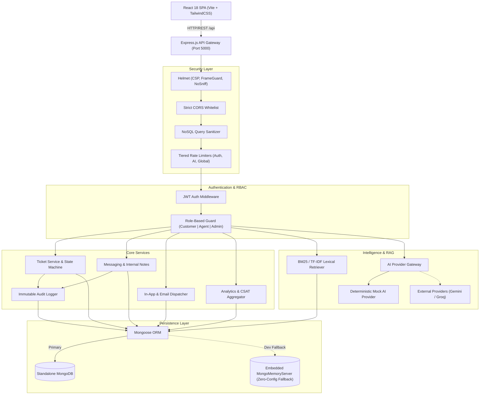
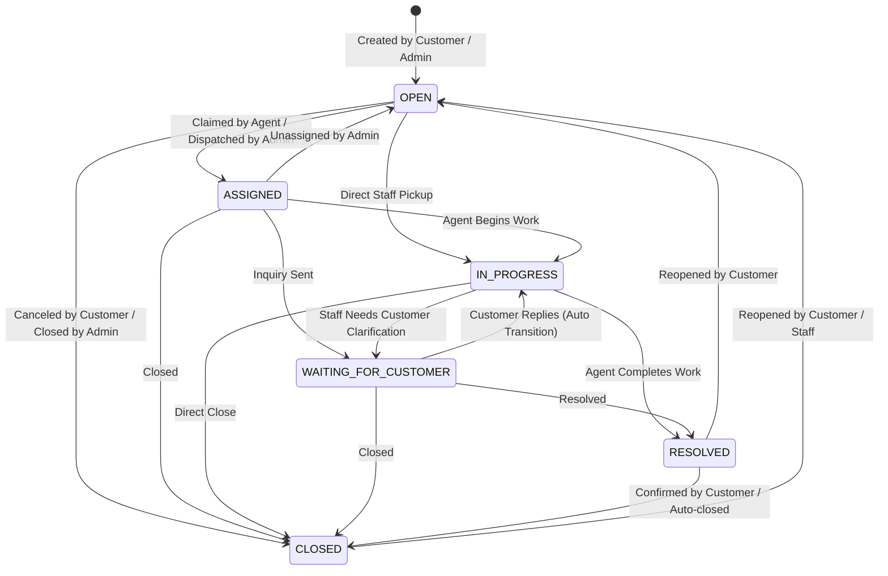

# System Architecture Documentation

## Overview

The **AI Support & Operations Platform** is an enterprise-grade customer support, agent workflow, and service operations system. It combines deterministic state-machine ticket management, role-based access control (RBAC), private internal collaboration, automated SLA/CSAT analytics, lexical Retrieval-Augmented Generation (RAG), and an extensible AI provider abstraction.

---

## Architectural Diagram

---

## Component Deep Dive

### 1. Presentation Tier (Frontend)
- **Framework**: React 18 with Vite for modern module bundling and hot module replacement (HMR).
- **Styling**: TailwindCSS with bespoke dark-mode design system, accessible color contrast, micro-animations, and glassmorphism cards.
- **Portals**:
  - **Customer Portal**: Ticket submission, ticket timeline, real-time unread notifications, CSAT star reviews, and public knowledge base search.
  - **Agent Portal**: Unassigned queue, assigned workload tracking, one-click ticket claiming, status transitions, conversation threads, and private internal notes.
  - **Admin Command Console**: Organization-wide ticket dispatch, user and agent management, knowledge base article editor, and CSAT / SLA analytics dashboards.
- **State & Session**: JWT stored securely in client state with Axios request interceptors and automatic session-expiry listeners (`auth:expired`).

### 2. API Gateway & Middleware Pipeline (Backend)
1. **Security Headers**: Powered by `helmet` with custom Content-Security-Policy (CSP) in production, `X-Content-Type-Options: nosniff`, and `X-Frame-Options: SAMEORIGIN`.
2. **CORS**: Strict domain validation against `CLIENT_URL` in production; dev-friendly localhost origins in development.
3. **NoSQL Sanitizer**: Custom recursive sanitizer removing all MongoDB operator keys (`$gt`, `$ne`, `$regex`, etc.) from incoming bodies, query parameters, and route parameters.
4. **Rate Limiting**: Multi-tiered rate limiters via `express-rate-limit`:
   - Authentication: 15 requests per 15 minutes in production (2,000 in dev).
   - AI / RAG operations: 40 requests per minute in production (1,000 in dev).
   - Global API: 300 requests per 15 minutes in production (5,000 in dev).
5. **Centralized Error Handling**: Unified envelope (`{ success: false, error: { message, code, details } }`), raw user input reflection prevention on `CastError`, and masked 500 error messages in production.

---

### 3. Ticket State Machine

Tickets progress strictly through allowed state transitions enforced on the backend:

#### State Transition Rules
- **Customers** can only close their own tickets or reopen resolved/closed tickets.
- **Agents** can only update the status of tickets assigned to them.
- Direct transition from `ASSIGNED` to `RESOLVED` is prohibited; tickets must transition through `IN_PROGRESS` to ensure verifiable handling.

---

### 4. Privacy & Authorization Boundaries

| Boundary | Enforcement Point | Behavior |
| :--- | :--- | :--- |
| **Internal Notes Isolation** | `messageController.js` & `ticketController.js` | Customers are blocked from creating internal notes (`403`). `isInternal: true` messages and `INTERNAL_NOTE_ADDED` audit entries are filtered out of all customer API responses. |
| **Cross-Customer Isolation** | `ticketController.js` & `messageController.js` | All customer ticket requests enforce `ticket.customer === req.user._id`. Cross-customer reads or writes return `403 Forbidden`. |
| **Agent Reassignment Boundary** | `ticketController.js` (`assignTicket`) | Agents can only claim unassigned tickets (`assignedAgent: null`). Only Admins can reassign tickets between agents. |
| **Agent Metadata Editing** | `ticketController.js` (`updateTicket`) | Agents can only modify title/description on tickets assigned to them. |
| **CSAT Submission Eligibility** | `ticketController.js` (`submitTicketFeedback`) | Only eligible on `RESOLVED` or `CLOSED` tickets owned by the requesting customer. Duplicate reviews return `409 Conflict`. |
| **Unpublished Knowledge Drafts** | `articleController.js` | Ordinary users and customers can only query `isPublished: true` articles and chunks. Unpublished drafts are restricted to Admins. |

---

### 5. Knowledge Base & Lexical RAG Engine

The platform includes a native, self-contained Retrieval-Augmented Generation (RAG) subsystem:
1. **Pre-chunking**: Articles are segmented into semantic paragraphs (100–300 tokens each) with preserved boundaries, heading context, and metadata upon creation/update.
2. **Retrieval Algorithm**: Uses a lexical TF-IDF / BM25 scoring algorithm that tokenizes search terms, eliminates common English stopwords, stems terms, and computes term frequency $\times$ inverse document frequency across article chunks.
3. **Draft Privacy**: The retriever enforces `{ isPublished: true }` for non-admin callers, guaranteeing unpublished internal drafts are never retrieved in public search or Q&A.
4. **Grounded Synthesis**: Retrieved chunks are injected as grounded context into the AI provider. If context is insufficient, the engine returns an honest fallback without hallucination.

---

### 6. AI Provider Gateway Abstraction

The AI subsystem uses a provider-agnostic Strategy pattern (`AIService`):
- **Mock Provider (Active)**: Deterministic, rule-based classification and reply generator. Runs 100% locally with zero external API keys, zero network latency, and reproducible test fixtures.
- **Pluggable Architecture**: Implements standard interface methods (`analyzeTicket`, `generateSuggestedReply`, `answerKnowledgeQuery`). Adding real providers (Google Gemini or Groq) requires registering credentials in `env.js` without altering controller or frontend code.
- **Security Boundary**: AI suggestions are advisory; AI output can never automatically reassign ticket ownership or elevate user roles.

---

### 7. Dual Database Strategy (Zero-Config Development)

- **Standalone MongoDB**: In production or standard environments, connects to `MONGODB_URI` (`mongodb://127.0.0.1:27017/ai_support_platform`).
- **In-Memory Fallback (`mongodb-memory-server`)**: In development mode, if a local MongoDB instance is unreachable after a 2.5-second timeout, the server automatically starts an embedded, in-memory MongoDB instance. This enables instant clone-and-run local development without requiring Docker or a local database installation.
